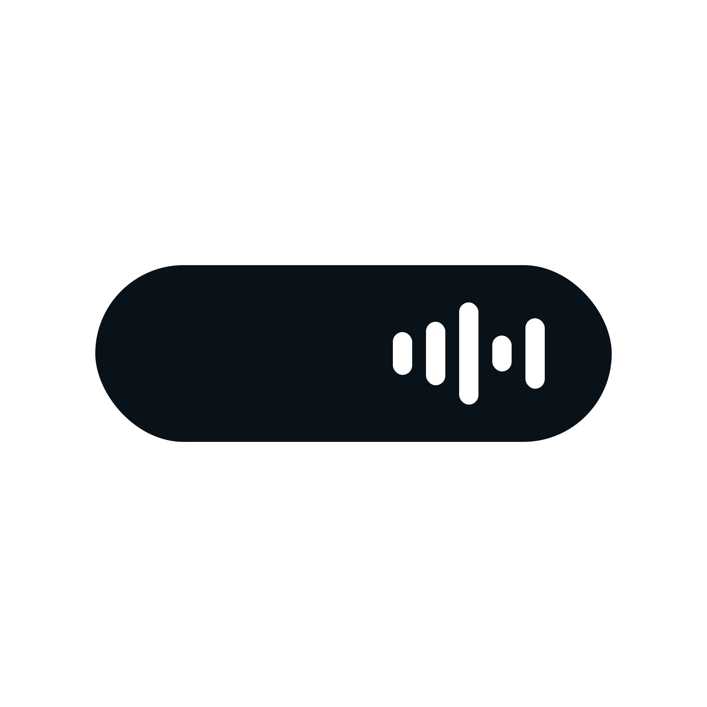

# Holm

A Dynamic Island–style notch for Windows. It sits at the top of your screen, shows what's playing with full controls, tints itself in the colours of the album cover, pops out your messages and downloads, sends files to your friends AirDrop-style and keeps an eye on your laptop and Bluetooth headphone battery – while using almost no resources.

*Holm was called WinNotch up to version 1.5.0. Your settings carry over when you switch.*

<p align="center">
  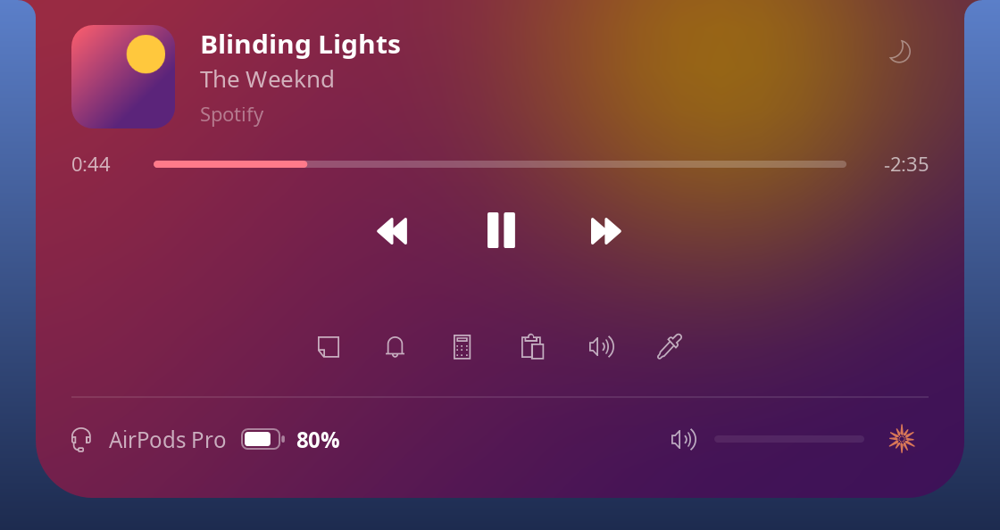
  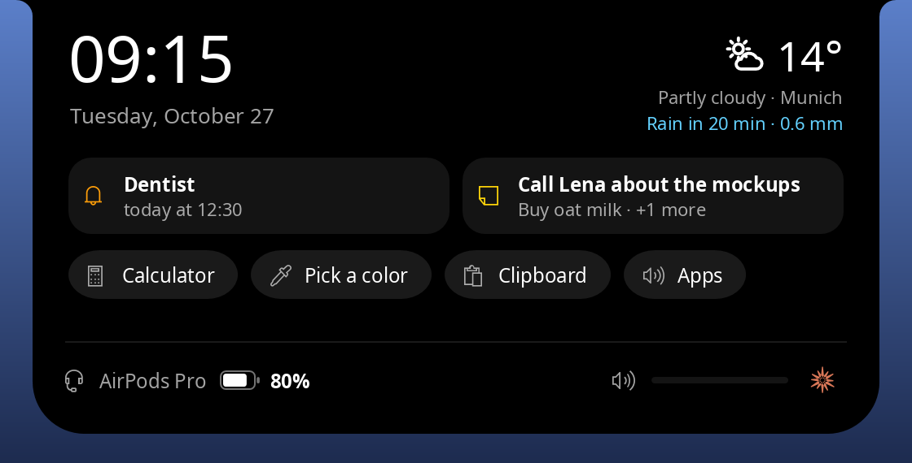
</p>
<p align="center">
  
  
  
  
  
  
  
  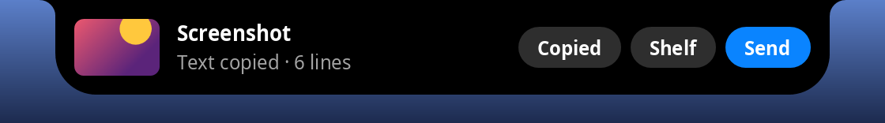
</p>

## Features

- **Today at a glance** – idle, the notch shows the time (or the weather) and the one thing that matters most: the next reminder today, else what's on the shelf. Open without music, it's a card for today: time and date, the weather, the next reminder, your note, and the tools you reach for most.
- **Tools in the open notch** – notes, reminders, a calculator, the clipboard history, a mixer and a color picker, each a click away in the tool bar (and on the today card). The notch only takes the keyboard while you type into one of its fields.
- **Notes** – a small note that survives a restart and stays on this PC.
- **Reminders in plain words** – "20 min laundry", "14:30 dentist", "tomorrow 9:00 call" (German works too). The notch rings on time with *+10 min*; reminders survive a restart, and one missed while the PC was off shows when it's back.
- **Calculator** – type a sum, the result is there at once; click it to copy. "50 + 15%" works like on any calculator.
- **Clipboard history** – the last 20 texts and pictures you copied; click one to put it back. Passwords that password managers mark as private are never read or kept, and a copied password leaves the clipboard after 30 seconds if it's still there. The history lives in memory only.
- **Color picker** – click anywhere on the screen to copy that color's hex code.
- **Text from screenshots** – *Copy text* on the screenshot pop-out reads the text with Windows' own OCR, on your PC.
- **Volume per app** – a slider for each app that plays sound; click its icon to mute it.
- **Weather** – temperature in the idle notch, the sky and the next hour's rain when it's open, for the city you type in. From [Open-Meteo](https://open-meteo.com) without an account, at most every 30 minutes.
- **Quiet hours** – from one time to another, messages don't pop out (they still count on the badge); apps and people you choose still do.
- **Sleep timer** – the moon in the open player stops the music after 15, 30 or 60 minutes. Music also pauses for calls and plays on afterwards.
- **Heads-ups** – Caps Lock on or off, a USB stick plugged in (*Open*, *Eject*), the internet gone and back (with how long), and once when the system drive runs low.
- **Media controls** for anything that talks to Windows' media controls – Spotify, YouTube in Chrome or Edge, VLC, … Cover, title, album, seek bar, play/pause, skip, **shuffle and repeat**, volume. Click the cover to bring the player to the front.
- **Album colours** – the notch is washed in a blurred copy of the cover and crossfades when the track changes.
- **Volume pop-out** – change the volume with your keys or the taskbar and the notch shows it, like a phone does.
- **Output device** – the button next to the volume lists your speakers, headphones and headsets; pick one and all sound (music, games and calls) goes there, like in Windows' Sound settings. It shows up when there's more than one to choose from.
- **Bluetooth** – the Bluetooth button next to the volume switches Bluetooth on and off and lists your paired devices, with a tick at the connected ones. Click headphones or a speaker to connect or disconnect them, like the *Connect* button in Windows' Bluetooth settings. Mice, keyboards and phones are listed too but connect by themselves (Windows doesn't let apps do that for them). *Add a device…* and *Bluetooth settings* are one click away.
- **VPN** – while a VPN is connected, a small lock sits in the idle notch and a green one next to the batteries, and the notch says when it connects or drops. It knows Windows' own VPN connections and the usual apps (WireGuard, OpenVPN, NordVPN, Proton VPN, Mullvad, Cisco, GlobalProtect, FortiClient, …). Right-click › *VPN indicator* turns it off.
- **Microphone and camera dot** – like on a phone, a small dot beside the notch shows while an app records: orange for the microphone, green for the camera. The notch says which app when it starts, and the open notch lists them with a button that mutes the microphone for every app (and for calls). It reads the record Windows keeps for its own privacy settings, so nothing is polled; right-click › *Microphone and camera dot* turns it off.
- **Calls** – while you're in a call in Discord, Teams, Zoom, WhatsApp, Slack or the browser (Meet and the like), the notch shows the app and how long the call runs, with a red mark when your microphone is muted; open it to mute or unmute. When the call ends, the notch says how long it was.
- **Shelf** – drop files or folders on *Shelf* in the drop view to park them in the notch, switch to the folder or window where they should go, and drag them out of the open notch (one, or all at once by the *Shelf* title). Dropped on a folder on the same drive they move, elsewhere they're copied – like dragging from Explorer. A small count in the idle notch shows what's waiting; only the paths are kept, and the shelf works with Beam off too.
- **Screenshots** – take one (Win+Shift+S, Print Screen, Win+Print Screen) and it pops out of the notch, small, with *Send* – click a friend, someone nearby, *Phone* or *Code* instead of dragging – and *Shelf*; click the picture to open it. Holm watches the Screenshots folder and, for snips that only go to the clipboard, the Snipping Tool's clipboard; images you copy anywhere else are left alone.
- **Timer** – right-click › *Timer* and pick 1 minute to 1 hour. The time left counts down in the notch (in place of the equalizer while music plays), with pause and stop when you open it; when it's up, the notch rings and offers five more minutes.
- **Beam** (Holm's AirDrop) – drop files or folders on the notch and beam them to a friend anywhere, to someone on the same network, or to anyone with a code (see below). Copied text can be beamed too, and a friend whose Holm isn't running gets the files once it is.
- **Separate sizes** – choose Small, Normal, Large or Extra large independently for the collapsed notch and the expanded panel. Pop-outs and Beam prompts follow the collapsed size.
- **Updates in the app** – checks for stable releases shortly after startup and every two hours. Right-click › **Updates** to check now, switch automatic checks off, or install an available update and restart.
- **Battery levels** for your laptop and Bluetooth devices (the same values Windows Settings shows).
- **Live activities** – short pop-outs when headphones connect, the charger is plugged in or the battery runs low.
- **AI button** – one click opens Claude, Gemini or ChatGPT: the desktop app if you have it (also Store apps and web apps installed from Edge or Chrome), the website otherwise. Or pick any app you like.
- **Messages** from WhatsApp, Discord, Outlook, Telegram, Signal and Slack – also when they run in the browser. A new message pops out of the notch with who wrote and the first line, and a badge in the app's colour counts what you haven't seen yet. Opening the app (or clicking the message in the notch) clears it. Each app can be switched off.
- **Downloads** – while your browser saves a file to Downloads, the notch shows its name, size and speed; when it's done, *Open* or *Show* it in Explorer with one click.
- **Stays out of your way** – hides during fullscreen games and videos, never steals focus, works on any monitor.
- **Right-click menu** – short again: timer, sleep timer, beam text, receive with a copied code, friends (waves too), **Settings…**, *Customize* (messages with one switch per app, quiet hours, weather, AI button, collapsed and expanded size), updates, pick a screen, quit.
- **Settings window** – *Settings…* opens every on/off switch in a window of its own, in groups: general (animations, minimize when idle, start with Windows), pop-outs (downloads, screenshots and their text, Caps Lock, low disk space, USB drives, internet connection), the open notch's tools (notes, reminders, calculator, clipboard history, volume per app, color picker), calls and privacy (calls, pausing music for calls, microphone and camera dot, VPN, clearing copied passwords) and Beam (Beam, sending folders, sending later). Esc closes it.

  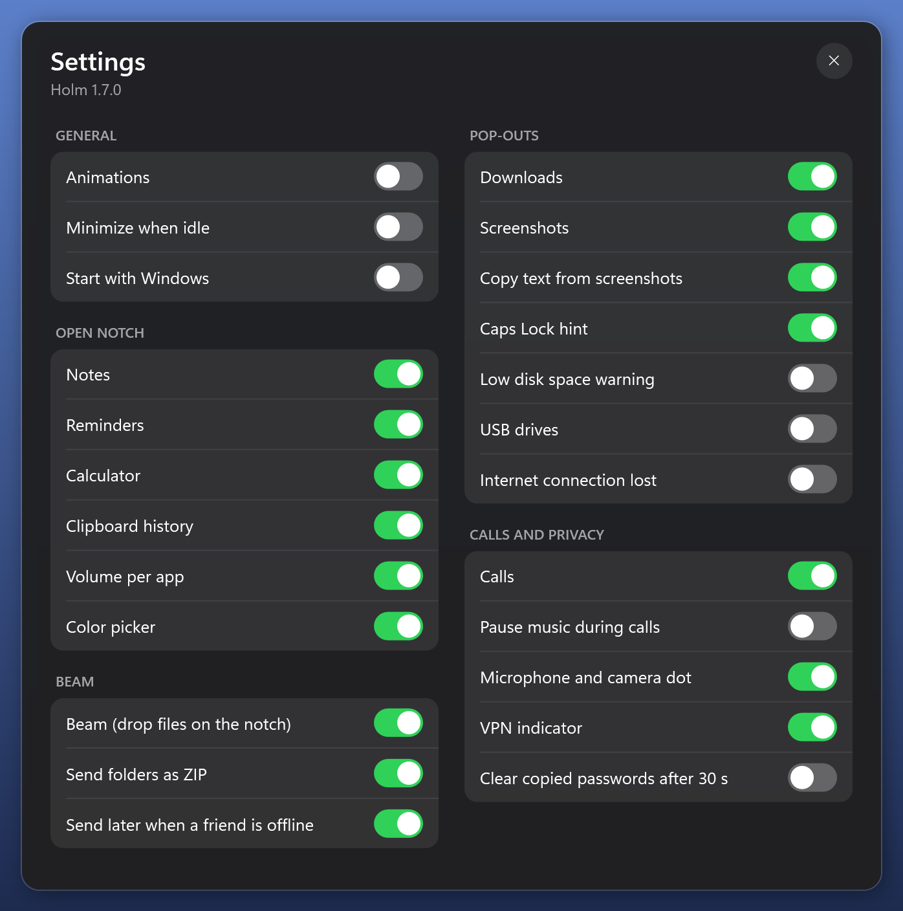

<p align="center">
  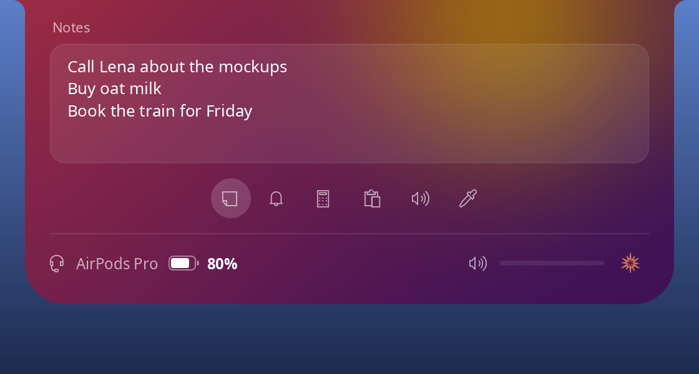
  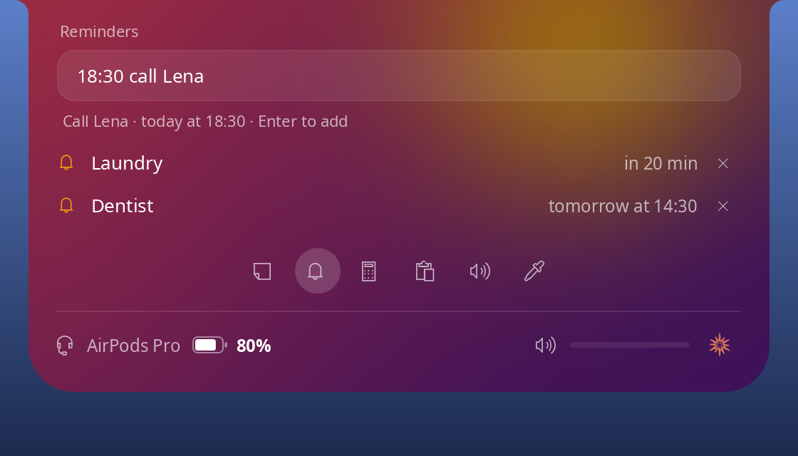
  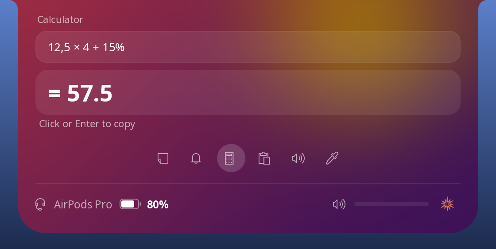
  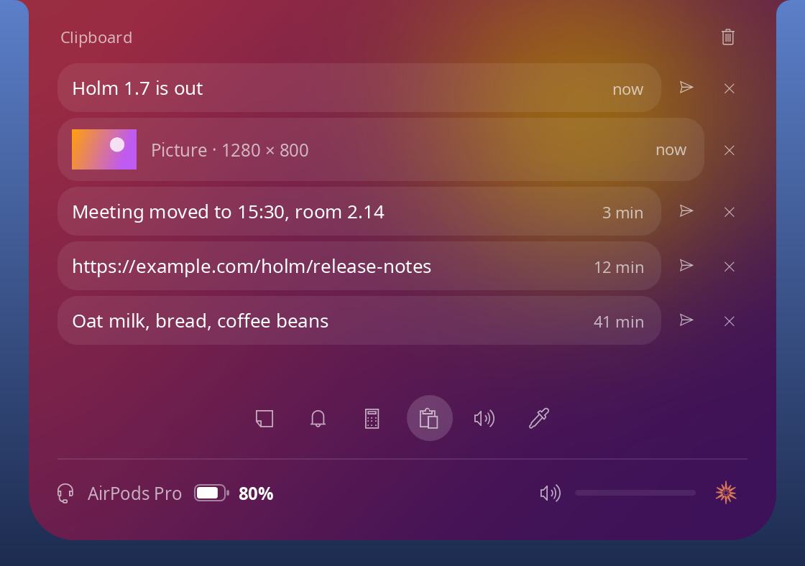
  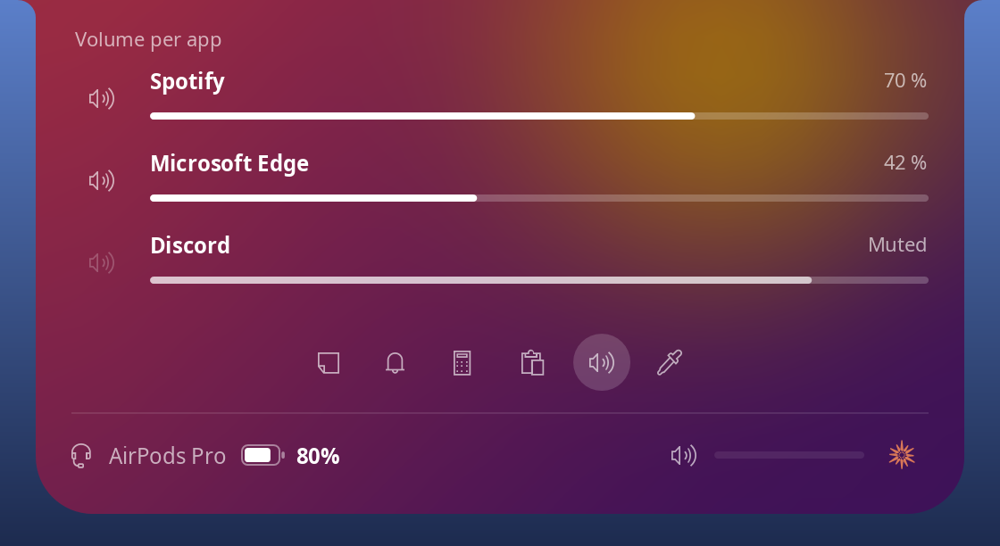
  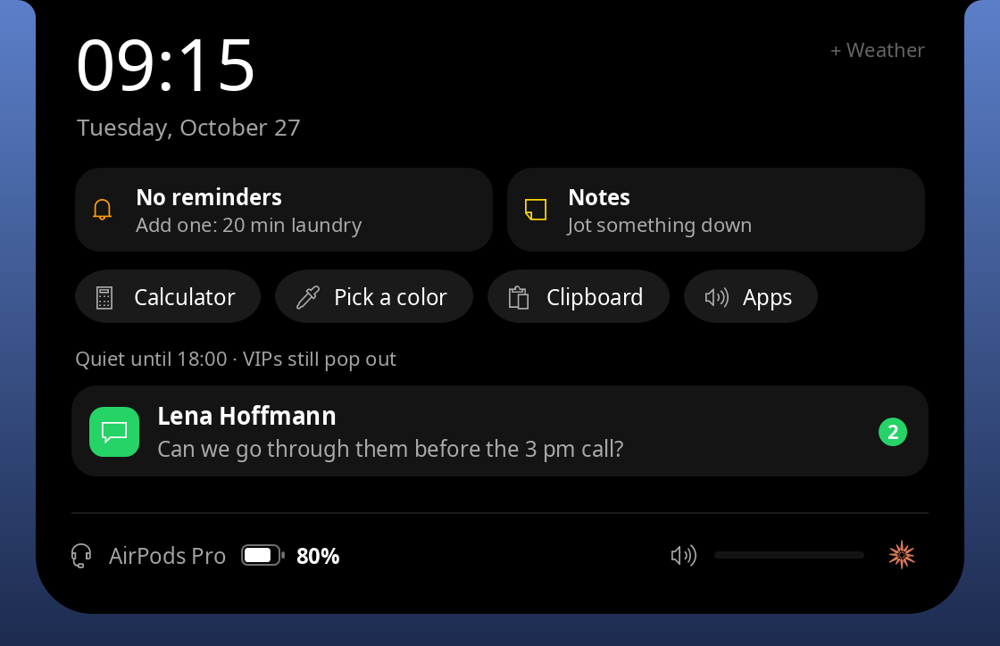
  
  
  
  
  
  
</p>

<p align="center">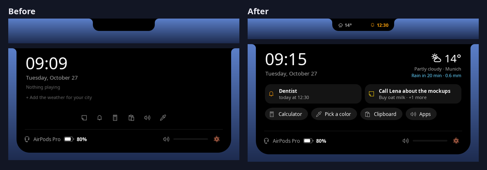</p>

## Beam

<p align="center">
  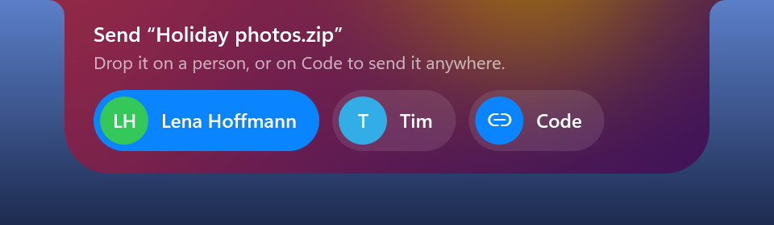
  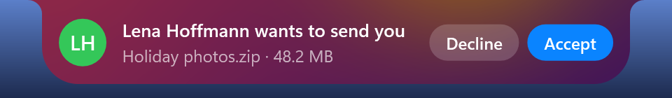
  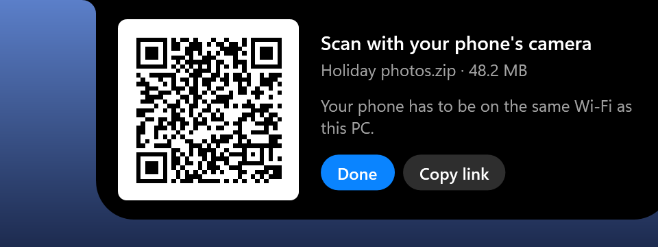
  
  
  
</p>

Drag files onto the notch. It opens and shows:

- **Friends** – people you added once (see below). Works anywhere: at home, at school, on a hotspot, on different networks. Drop the files on a friend and their notch asks *Accept* or *Decline*; no code to pass around.
- **People nearby** – everyone running Holm on the same network. Drop the files on a person and their notch asks *Accept* or *Decline*.
- **Phone** – drop the files on *Phone* and the notch shows a QR code. Point your phone's camera at it: a page with the files opens in the phone's browser, to download (or open photos, videos and PDFs right away). No app, no cable, no cloud – the files come straight from your PC over the Wi-Fi, so the phone has to be on the same network. The link carries 128 random bits, serves those files and nothing else, and stops when you click *Done*, ten minutes after it opened, or shortly after everything reached the phone.
- **Code** – works anywhere, also on networks that don't let devices talk to each other (school, office, hotspots). Drop the files on *Code* and a code like `WN-K7Q2A-…` is copied for you. Paste it to your friend in any chat; as soon as they copy it, their notch offers to receive the file. Right-click › *Receive with copied code* does the same.

Received files land in your **Downloads** folder. A **folder** goes as a ZIP (packed for the trip, deleted afterwards). **Text** you beam (*Beam text › Beam copied text…*, or the arrow next to a text in the clipboard history) lands on the other person's clipboard; Holm before 1.7 saves it as a text file in Downloads instead.

### Friends

1. Right-click the notch › **Friends › Copy my friend code** and send it to your friend in any chat.
2. Your friend copies your code and chooses **Add**. Their Holm waits while yours asks you to *Accept* or *Decline* the request. Neither friend list changes until you accept; acceptance adds each of you to the other's list.
3. If your friend cancels while you're deciding, their pending request closes on your Holm. From then on you show up in each other's notch (with a small star) whenever you drag files onto it. A **green dot** means their Holm is running right now, so they'll see your files at once.

Both notches have to be running for a friend request or file transfer. If your friend's notch doesn't answer within 15 seconds, the files wait (*Send later*, shown in the open notch with *Don't send*) and go as soon as their Holm is back: Holm asks every 15 minutes for two hours, then hourly, and every six hours leaves a sealed "something waits" note that their Holm answers when it starts. After a week it gives up. A friend request with no answer after two minutes is cancelled on both ends and leaves both lists unchanged.

**Waves.** Friends › *Wave at* pops up on your friend's notch with *Wave back*; only your name travels, sealed like every note, at most once per friend every 30 seconds.

How it works: dropping files on a friend makes a fresh one-time code, exactly like *Code*, but instead of you pasting it into a chat, Holm leaves it in your friend's **inbox**, sealed so only they can open it. Their notch picks it up within a second and comes to the relay by itself. The inbox is a topic on [ntfy.sh](https://ntfy.sh), a free public notification service; it only ever carries these small sealed notes, never files, so there is no size limit beyond the usual one. If a network blocks ntfy.sh, use *Code* there.

How it stays safe:

- **Nothing arrives without a yes.** The receiver sees who is sending what (names and sizes) and has to accept; no answer within a minute counts as no.
- **Only friends see that you're online.** When you drag files onto the notch, it asks your friends' notches whether they're running (a sealed note, like the others), and theirs answer the same way – at most once a minute per friend, as every note counts against ntfy.sh's daily limit. Questions from anyone who isn't your friend get no answer.
- **Only friends can knock.** A friend's note is sealed with a key only the two of you share (from your friend codes), so nobody else can open it or send one in your friend's name; notes from people you haven't added are ignored. Your private key never leaves your PC and is stored encrypted for your Windows account. ntfy.sh sees which inbox got a note and when, the IP addresses involved and a key that stands for the sender's notch – but no names, no files and not what the note says.
- **Encrypted.** With a code, the key comes from the code itself, so only the person you gave the code to can read the file. On the network both notches agree on a fresh key for every transfer (ECDH); that stops anyone from listening in, but the notches don't verify each other, so someone on the same network could pretend to be a notch – use *Code* on networks you don't trust. Everything is sent with AES-256-GCM, so changed or replayed data is rejected.
- **Through the relay, only scrambled bytes.** Code transfers go through the public *transit relay* of the open-source [magic-wormhole](https://github.com/magic-wormhole/magic-wormhole) project. It only pairs the two sides and passes encrypted data along – it never sees the code, the key, file names or content. A code works once and expires after 15 minutes.
- **Files stay where they belong.** File names are cleaned up, so nothing can be written outside Downloads and no invisible text-direction marks can disguise `holiday‮gpj.exe` as a picture; existing files are never overwritten (you get `photo (1).jpg`); a cancelled transfer leaves no half file behind.
- **Marked as downloaded.** Received files get Windows' "from the internet" mark, so Windows warns before running a received program, just like with a browser download.
- To be found on the network, Holm listens on UDP port 47811 and a TCP port, so Windows Firewall may ask once. Turn Beam off in the right-click menu if you don't want any of it (that also closes the friends inbox).

## Lightweight

Native WPF on .NET 10, with event driven updates where Windows provides them. While the notch is open, it redraws the clock only when the minute changes and the volume controls only when their displayed values change. Bluetooth battery scans run in the background so device enumeration does not pause the notch; a second scan is skipped while one is still running.

| State | CPU | RAM (Task Manager) | Working set |
| --- | --- | --- | --- |
| Idle | ~0.02–0.03 % | ~20–35 MB | ~55–80 MB |
| Music playing, equalizer animated | ~0.3–0.5 % | ~45–55 MB | ~95–120 MB |

CPU and memory figures above were measured on an 8-thread laptop before the 1.5.8 redraw changes; they have not been remeasured for this release. Task Manager's *Memory* column is the private working set; the working set also counts the Windows libraries Holm shares with other apps. Holm hands its memory back to Windows 6 seconds after it starts, once more after its first update check, a few seconds after music stops and whenever the notch closes (then it's 1–5 MB for a moment), and grows back to these values as it touches things again – after music to about 18 MB (48 MB working set); what it has reserved stays flat, so nothing leaks. Turning off the equalizer animation brings playback down to idle levels.

**Messages** are event driven too. Windows only tells packaged (Store) apps when a notification arrives, so Holm watches the folder of Windows' notification database instead and looks only when it changes. Windows keeps the database open and often only reports a change once someone else opens the file, so Holm also compares a marker every 2 seconds that Windows rewrites with every change to the database – a fifth of a millisecond – and only reads when it moved; a new message shows up within 2–4 seconds. Asking the notification center for its notifications is the expensive part, so that only happens when a notification arrived, changed or went. **Downloads** work the same way: Holm is told when a file appears in Downloads and only measures sizes while a download is running.

## Messages

Holm reads the notifications of WhatsApp, Discord, Outlook (new, classic and the old Mail app), Telegram, Signal and Slack from the Windows notification center, so it needs **notification access**. It asks for it on the first start; if Windows says no, right-click › *Messages* › *Allow notification access…* takes you to the switch (*Settings › Privacy & security › Notifications*). The same apps in Chrome, Edge or Firefox count too (WhatsApp Web, Discord, Outlook on the web, Telegram Web, Slack). Right-click › *Messages* switches single apps off. Teams is left out on purpose: its messages never show up in the notch.

**When an app only sends a badge.** WhatsApp and the other supported messengers may update their taskbar number without leaving a Windows notification. Holm also reads these numeric badges: existing unread counts appear at startup, and an increase pops out the app name and count, such as *WhatsApp · 2 unread messages*. This fallback works even when notification access is unavailable. Opening an app clears its count in the notch without clearing the other apps.

Names and message text need a notification in Windows' notification center. With badge-only updates, Holm shows the count and also notices when Windows receives a fresh badge with the same number. If the app sends neither a notification nor a badge update, Holm has no new event to display.

To read the badge, Holm copies the notification database (and its write-ahead log) to a private temp folder, reads the badges from the copy and deletes it again – Windows' own files are only ever read. From the same copy it takes a fingerprint of the notifications (ids, times and a hash of each, never their text), so it only asks the notification center again when they changed. It uses the SQLite that ships with Windows, so there's no extra library.

Holm never removes or changes your notifications, and message text is never written to its logs.

Microsoft doesn't document reading notifications from an app that isn't installed as a package. Other unpackaged apps do it on current Windows 11 builds; where Windows refuses, the menu says so, and available numeric app badges still work.

## Requirements

Windows 10 (2004 or newer) or Windows 11, x64.

## Updating

Right-click the notch › **Updates › Check for updates** to look for a new stable GitHub release. **Check automatically** is on by default. When a new version is available, **Update to … and restart** downloads and verifies it, then replaces the running app in the same location. Your settings, friends and shortcuts stay in place. Downloads and installation start only when you choose to update.

Updates work with the published Windows x64 app in a folder your account can write to. Holm waits until file-sharing activities are finished before offering to restart, keeps a backup during replacement, and restores it if the new app cannot start. Development builds can check for releases but cannot replace themselves.

## Build

You need the [.NET 10 SDK](https://dotnet.microsoft.com/download).

```powershell
dotnet publish (Get-ChildItem -Recurse -Filter '*.csproj' | Where-Object { $_.Name -notlike '*Tests.csproj' } | Select-Object -First 1).FullName -c Release -r win-x64 --self-contained false -p:PublishSingleFile=true -o publish
```

Some source folder and protocol identifiers retain their original names so Holm can exchange files with earlier versions. This gives you `publish/Holm.exe`, which needs the .NET 10 Desktop Runtime. For a single exe that runs anywhere without installing .NET, use `--self-contained true -p:IncludeNativeLibrariesForSelfExtract=true` instead.

## Tests

```powershell
dotnet test (Get-ChildItem -Recurse -Filter '*Tests.csproj' | Select-Object -First 1).FullName
```

The suite covers recognising messengers (also in the browser), Windows notification badges, downloads, Beam codes and friend codes, sealed friend notes and request responses, encryption, transfer safety, network discovery, and end-to-end file transfers. Online tests need an internet connection; skip them with `--filter "Category!=Online"` or configure your own test servers. An optional end-to-end toast test leaves silent notifications (no pop-up) from Outlook, Teams and an unrelated app in the notification center, reads them back the way the notch does – only Outlook's may count – and removes them again – quit a running notch first. WhatsApp badge fallback and pop-outs are covered by the badge tests because some Windows installations will not accept synthetic WhatsApp notifications.

Update tests cover release selection, download integrity, unsafe archives, menu states, replacement, restart and recovery using temporary executables. They never replace your installed Holm.

## Vibe coded

This project began by chatting with Claude (Anthropic's AI) in Claude Code, from the idea to the performance tuning. GPT-6 Astra (OpenAI), through Codex, now works on the project alongside Claude, helping with implementation, code review and testing. The human maintainers guide development and test the app on real machines. Expect some rough edges – issues and pull requests are welcome.

## Contributors

Alongside the human contributors recorded in the commit history, we credit Claude, Google Gemini and GPT-6 Astra as AI development contributors. See [CONTRIBUTORS.md](CONTRIBUTORS.md) for their contributions.

## License

Open source under the [MIT License](LICENSE).
