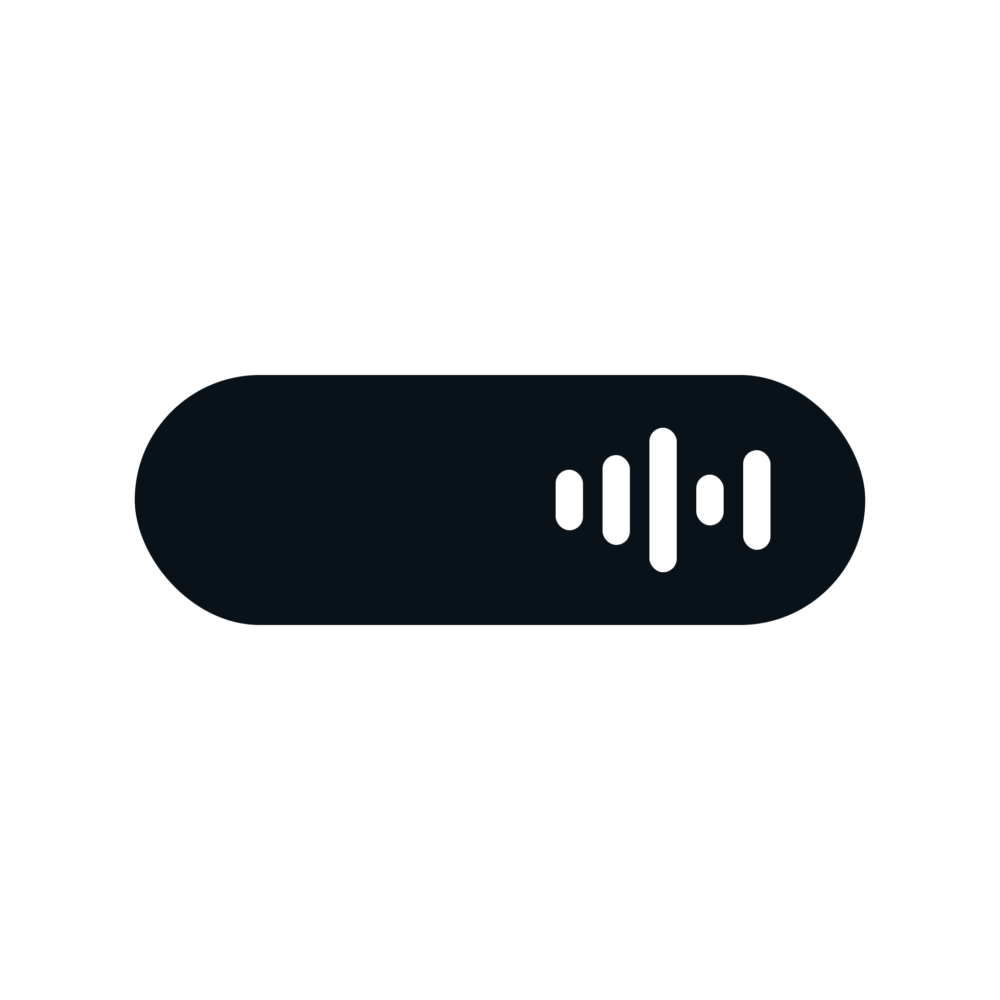
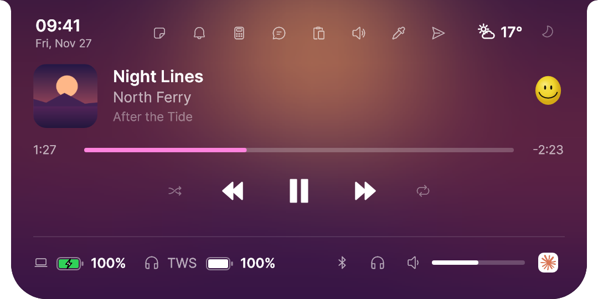
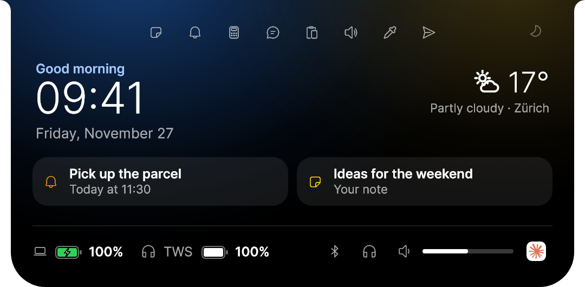
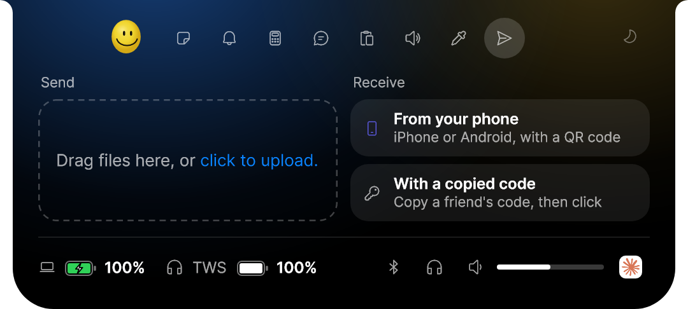
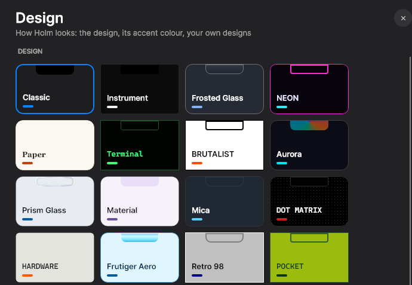

<p align="center">
  
</p>

<h1 align="center">Holm</h1>

<p align="center"><strong>A Dynamic Island-style desktop notch for Windows and Linux.</strong></p>
<p align="center">Control playback, see what needs your attention, and share files from the top of your screen.</p>

<p align="center">
  <a href="https://github.com/ademerci/Holm/releases/latest"></a>
  <a href="https://apps.microsoft.com/detail/9NZF994ZPFMH"></a>
  <a href="https://holmnotch.ch/"></a>
</p>

<p align="center">
  <a href="https://github.com/ademerci/Holm/releases/latest"></a>
  <a href="#install"></a>
  <a href="LICENSE"></a>
</p>

<p align="center">
  <a href="#install">Install</a> · <a href="#features">Features</a> · <a href="https://holmnotch.ch/docs/">User guide</a> · <a href="CHANGELOG.md">Release notes</a>
</p>

<p align="center">
  
  
</p>

## Install

| Platform | Requirements | How to start |
| --- | --- | --- |
| Windows | x64, Windows 10 version 2004 or later, or Windows 11 | Get Holm from the [Microsoft Store](https://apps.microsoft.com/detail/9NZF994ZPFMH), or extract the Windows ZIP and run `Holm.exe`. |
| Linux | x64, X11 or XWayland | Extract the Linux archive and run `./Holm`. |

Both portable builds are available on the [latest GitHub release](https://github.com/ademerci/Holm/releases/latest) and include the .NET runtime. Once Holm is running, move your pointer over the notch at the top of your screen to open it. Right-click the notch to open Settings.

## Features

| Feature | What you can do |
| --- | --- |
| Media | Play, pause, skip, seek, and adjust volume. The notch can pick up colours from the album art. |
| Live updates | See messages, downloads, and battery or connection status at a glance. System integration varies by platform. |
| Everyday tools | Check the weather and your next reminder, jot down a note, or open clipboard history and the calculator. |
| Beam and Shelf | Drop files on the notch to send them to friends or nearby devices. Keep files on the Shelf and drag them out when you need them. |
| Customisation | Rearrange the Start page, show or hide tools, and choose a design and accent colour. |

## Holm in everyday use

- **Skip a track while you work.** The collapsed notch shows what's playing. Hover over it to open the player, skip the track, or turn the volume down, then move your pointer away to return to what you were doing.
- **Find a download as soon as it finishes.** When a browser download completes, the notch pops out with the file name. Use **Show** to jump to it in your file manager.
- **Send a file or set it aside.** Drag a PDF onto the notch and choose a nearby device in Beam. If you need the file in another window, drop it on the **Shelf** and drag it back out once that window is open.

## Screenshots

<p align="center">
  
  
  <br>
  <em>Beam sharing and the Design picker</em>
</p>

## Help and feedback

- Visit the [user guide](https://holmnotch.ch/docs/) for setup, feature guides, and troubleshooting.
- [Open an issue](https://github.com/ademerci/Holm/issues) to report a bug or suggest a feature. For security reports, follow the [security policy](SECURITY.md).

## Contributing

Holm is built with Avalonia and .NET 10. Install the [.NET 10 SDK](https://dotnet.microsoft.com/download/dotnet/10.0), then build from the repository root.

**Windows**

```sh
dotnet build Holm.slnx -c Release
```

**Linux x64**

```sh
dotnet build Holm.App/Holm.App.csproj -c Release -r linux-x64
```

See [AGENTS.md](AGENTS.md) for the architecture, tests, and packaging workflow, and [CONTRIBUTORS.md](CONTRIBUTORS.md) for project credits.

## License

Holm is open source under the [MIT License](LICENSE). The AI usage rings and Claude limit reading are ported from [Codenotch](https://github.com/vinzdg/codenotch) by Vinz (MIT License).
