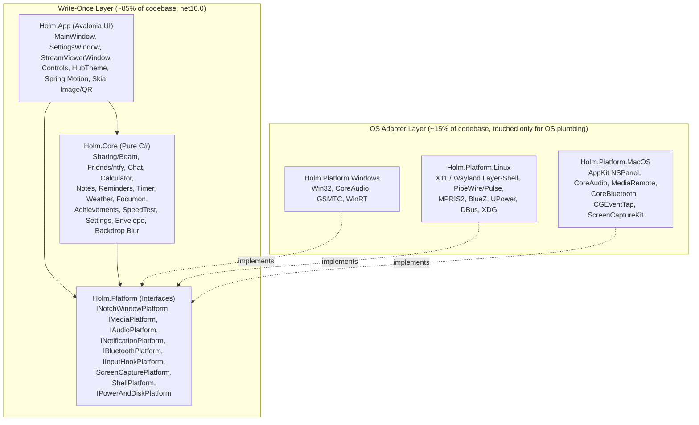

# Cross-Platform Rewrite Plan: Holm on Windows, Linux & macOS (Write-Once Architecture)

## Goal Description

Holm ([WinNotch.csproj](../../WinNotch/WinNotch.csproj)) currently targets `net10.0-windows10.0.19041.0` with `<UseWPF>true</UseWPF>` and mixes UI, business logic, and Windows P/Invoke / COM / WinRT APIs across ~140 files.

This plan restructures Holm so that:
1. **Zero Visual Change (100% Pixel-Identical Look & Motion)**: The notch shape, concave top shoulders, exact dimensions, colors, typography, 24×24 blurred album-art wash, custom vector controls, and analytical spring physics do **not** change by a single pixel.
2. **Write-Once Workflow**: Every UI view, animation, tool, and feature change is written **once** in shared C# + **Avalonia UI** (`net10.0`) and runs on Windows, Linux, and macOS without writing changes three times.
3. **Preserved Engineering Philosophy**: Every low-memory, zero-idle-CPU, and event-driven design decision in Holm's existing codebase is preserved and carried forward.
4. **Isolated OS Plumbing with Graceful Fallback**: OS-specific hooks sit behind focused interfaces (`IPlatform*`) with capability flags so Linux (X11 / Wayland) and macOS work seamlessly and degrade cleanly when a compositor restricts a hook.

---

## 1. Zero Visual Change Guarantee (1:1 Pixel-Identical Look, Feel & Motion)

> [!IMPORTANT]
> **Strict Visual Invariant**: Users on Windows will not be able to tell the difference between the current WPF build and the cross-platform build, and Linux/macOS users will see the exact same Holm UI down to every pixel, curve, color stop, and spring trajectory.

### How 100% Visual Identity Is Preserved

| Visual Element | Current Implementation in Holm | How It Stays 100% Identical in `Holm.App` |
|---|---|---|
| **Window Dimensions & State Sizes** | `BaseWidth = 560`, `ExpandedWidth = 520`, `MaxEar = 10` in [MainWindow.xaml.cs](../../WinNotch/MainWindow.xaml.cs#L15-L18).<br/>Closed idle: `(150, 30, r=15)`<br/>Closed active: `(220, 32, r=16)`<br/>Closed dual (media + timer/weather): `(276, 32, r=16)`<br/>Closed call: `(290, 34, r=17)`<br/>Peek compact: `(350, 54, r=24)`<br/>Peek tall: `(380, 68, r=24)`<br/>Expanded Media: `(520, 210, r=28)`<br/>Expanded Tools/Share/Speed: `(520, 256, r=28)` | Exact same `SizeFor(VisualState)` table in [MainWindow.Motion.cs](../../WinNotch/MainWindow.Motion.cs#L180-L246) copied verbatim without changing a single number. |
| **Concave Top Shoulders ("Ears") & Bottom Corners** | `UpdateShape(double w, double h)` in [MainWindow.xaml.cs](../../WinNotch/MainWindow.xaml.cs#L761-L793) constructs a `StreamGeometry` with 4 `ArcTo` segments:<br/>• Top-left concave ear (`SweepDirection.Counterclockwise`, radius `ear`)<br/>• Bottom-left convex corner (`Clockwise`, radius `r`)<br/>• Bottom-right convex corner (`Clockwise`, radius `r`)<br/>• Top-right concave ear (`Counterclockwise`, radius `ear`) | Avalonia's `StreamGeometry` (`BeginFigure`, `LineTo`, `ArcTo` with `SweepDirection`) uses the exact same SVG/WPF arc math on Skia and clips `Backdrop.Clip` on every animation frame with identical sub-pixel anti-aliasing. |
| **Color Palette & Brush Tokens** | Defined in [MainWindow.xaml](../../WinNotch/MainWindow.xaml#L14-L21) & [HubTheme.cs](../../WinNotch/HubTheme.cs#L13-L28):<br/>• Notch surface: `#FF000000` (pure black)<br/>• `Dim`: `#A6FFFFFF`, `Faint`: `#66FFFFFF`<br/>• `Hairline`: `#1AFFFFFF`, `PillFill`: `#1FFFFFFF`, `PillHover`: `#33FFFFFF`<br/>• `Accent`: `#FF0A84FF`, `Green`: `#FF30D158`, `Red`: `#FFFF453A`, `Amber`: `#FFFF9F0A`, `Purple`: `#FFBF5AF2`, `Indigo`: `#FF5E5CE6`, `Pink`: `#FFFF375F`<br/>• Hub `Panel`: `#FA1E1E20`, `Sidebar`: `#FF171719`, `Card`: `#FF2A2A2E` | Copied 1:1 with the exact same ARGB hex values in `MainWindow.axaml` and `HubTheme.cs`. |
| **Blurred Album Cover Backdrop Wash** | `MediaService.BackdropOf` in [MediaService.cs](../../WinNotch/MediaService.cs#L437-L501) downscales cover art to `24×24`, boosts saturation by `1.35×`, runs 3 passes of radius-3 `BoxBlur`, and sets `BackdropShade.Opacity = Math.Clamp(0.25 + lum * 0.65, 0.25, 0.8)` in [MainWindow.xaml.cs](../../WinNotch/MainWindow.xaml.cs#L618-L633). | Kept verbatim as pure C# pixel math on the 24×24 BGRA array, rendered with bilinear interpolation and the exact same luminance-adaptive `BackdropShade` opacity. |
| **Analytical Spring Physics** | `Spring` and `SpringValue` in [MainWindow.Motion.cs](../../WinNotch/MainWindow.Motion.cs#L319-L410):<br/>• `Spring.Open = (0.28, 0.80)`<br/>• `Spring.Close = (0.32, 0.88)`<br/>• `Spring.Peek = (0.35, 0.72)`<br/>• `ScaleTransform(scale, scale, 280, 0)` | The exact `Spring` struct and `SpringValue` class are kept unmodified, stepped by the render frame delta `dt`. |
| **Custom Drawn Controls (`OnRender`)** | `BatteryGlyph` and `MiniSlider` in [Controls.cs](../../WinNotch/Controls.cs#L13-L143), `ToggleSwitch` in [SettingsWindow.cs](../../WinNotch/SettingsWindow.cs#L828-L886) draw rounded rects, ellipses, and geometries directly in `OnRender(DrawingContext)`. | Avalonia's `Control.Render(DrawingContext)` exposes the same `DrawRectangle`, `DrawRoundedRectangle`, `DrawEllipse`, and `DrawGeometry` primitives with identical coordinates (`22×11` battery body, `4px` slider track, `6px` thumb radius, `38×22` toggle switch). |
| **Typography & Icon Codepoints** | Uses `Segoe Fluent Icons` / `Segoe MDL2 Assets` codepoints (`\uE768` Play, `\uE769` Pause, `\uE74F` Mute, `\uE720` Mic, `\uE702` BT, etc.) and system sans-serif font weights (`SemiBold`, `Bold`, `Light`). | Bundle a dedicated icon font resource mapping those exact Unicode codepoints (`\uE700`–`\uF8FF`) plus `Inter` / `Segoe UI Variable` metrics as embedded resources so every glyph and text box aligns identically on Windows, Linux, and macOS. |

---

## 2. How and Why Holm Is Written Like This (Architectural Deep-Dive)

Before changing a single line of code, it is essential to understand **how** Holm is currently written and **why** specific non-obvious choices were made across the codebase. Every one of these engineering principles must be preserved in the cross-platform architecture.

### 2.1 Why Single-File Uncompressed ReadyToRun & Non-Concurrent GC ([WinNotch.csproj](../../WinNotch/WinNotch.csproj))

In [WinNotch.csproj](../../WinNotch/WinNotch.csproj#L14-L39), Holm configures a very specific combination of .NET runtime and publish flags:
- **`<EnableCompressionInSingleFile>false</EnableCompressionInSingleFile>`**:
  - *Why*: When single-file compression is enabled, the .NET host must decompress every loaded assembly into **private heap memory** at startup instead of memory-mapping pages directly from the executable on disk. Turning compression off drops idle private memory from **148 MB (256 MB peak)** down to **42 MB (130 MB peak)** and cuts startup CPU by a third.
- **`<PublishReadyToRun>true</PublishReadyToRun>` + `<PublishReadyToRunComposite>false</PublishReadyToRunComposite>`**:
  - *Why*: ReadyToRun pre-compiles hot startup paths to native machine code so the notch appears in ~0.7s without a JIT storm. However, `PublishReadyToRunComposite` bundles native code for *all* of WPF and WindowsBase (even unused classes) into a massive 128 MB native image. Keeping `Composite=false` compiles per-assembly and keeps the executable ~59 MB smaller.
- **`<TieredCompilation>false</TieredCompilation>`, `<TieredPGO>false</TieredPGO>`, `<ConcurrentGarbageCollection>false</ConcurrentGarbageCollection>`**:
  - *Why*: Holm is an always-on desktop overlay that sits idle 99% of the day. With tiered JIT and PGO enabled, timer callbacks (`1s` clock/countdown ticks) eventually cross the 30-call threshold and trigger background Tier-1 JIT recompilation threads, permanently growing private working set by 3–5 MB and burning background CPU. Disabling tiered JIT and concurrent GC compiles each method once at Tier-1 and keeps GC synchronous and compact.
- **How the Rewrite Preserves This**: `Holm.App.csproj` carries over these exact MSBuild properties (`EnableCompressionInSingleFile=false`, `PublishReadyToRun=true`, `PublishReadyToRunComposite=false`, `TieredCompilation=false`, `TieredPGO=false`, `ConcurrentGarbageCollection=false`) across Windows, Linux, and macOS builds.

### 2.2 Why Analytical Spring Physics & Render-Tick Unhooking ([MainWindow.Motion.cs](../../WinNotch/MainWindow.Motion.cs))

Instead of using WPF `Storyboard` or `DoubleAnimation` keyframes, Holm implements its own physics solver in [MainWindow.Motion.cs](../../WinNotch/MainWindow.Motion.cs#L319-L410):
- **How It Works**:
  - Five independent `SpringValue` instances (`_wSpring`, `_hSpring`, `_rSpring`, `_earSpring`, `_scaleSpring`) track both `Value` and `Velocity`.
  - On each `CompositionTarget.Rendering` tick (`OnFrame`), `SpringValue.Step(dt)` solves the exact analytical solution to the second-order damped harmonic oscillator differential equation:
    - Underdamped ($\zeta < 1$): $x(t) = \text{Target} + e^{-\zeta \omega t} \left( x_0 \cos(\omega_d t) + \frac{v_0 + \zeta \omega x_0}{\omega_d} \sin(\omega_d t) \right)$
    - Critically damped ($\zeta \ge 1$): $x(t) = \text{Target} + e^{-\omega t} (x_0 + (v_0 + \omega x_0) t)$
- **Why It Is Written This Way**:
  1. **Velocity Preservation on Mid-Flight Interruption**: If the user hovers over the notch (starting expansion to `520×210`) and moves the mouse out 80ms later, or a notification peek arrives while collapsing, keyframe animations either snap or restart with zero velocity. `SpringValue.SetTarget(target, spring)` keeps the current `Value` and `Velocity` intact and redirects the trajectory smoothly without a jerk.
  2. **Frame-Rate Independence**: Because it uses the closed-form analytical integral over `dt` (rather than Euler integration), the spring trajectory is identical on a 60 Hz laptop panel, a 144 Hz gaming monitor, or a 120 Hz ProMotion MacBook display, and never explodes if a frame hitch occurs (`dt` clamped to `0.05s`).
  3. **Zero Idle CPU (`StopMotion`)**: As soon as all five springs are within `0.25px` of `Target` and `|Velocity| < 2.0`, `IsSettled` becomes `true`, and `StopMotion()` detaches `CompositionTarget.Rendering -= OnFrame` so zero render callbacks run while idle.
  4. **Deferred Heavy Work (`FinishOpening`)**: Enumerating audio output endpoints (`RefreshOutput`), Bluetooth devices (`RefreshBluetooth`), and AI CLI paths (`ResolveAi`) takes several milliseconds of synchronous IPC. Running that on mouse-enter would drop the first 2–3 frames of the expansion animation. Instead, [MainWindow.Motion.cs](../../WinNotch/MainWindow.Motion.cs#L156-L162) sets `_openPending = true` and runs `FinishOpening()` inside `OnShapeSettled()` *after* the spring animation finishes.
- **How the Rewrite Preserves This**: `Spring`, `SpringValue`, `MorphTo`, `StopMotion`, and `FinishOpening` are moved 100% intact into `Holm.App`, driven by Avalonia's render frame loop.

### 2.3 Why `StreamGeometry` Clipping & 24×24 CPU Box Blur Instead of GPU `BlurEffect` ([MainWindow.xaml.cs](../../WinNotch/MainWindow.xaml.cs) & [MediaService.cs](../../WinNotch/MediaService.cs))

- **How the Notch Shape Is Drawn**:
  - `MainWindow` is a fixed `560×260` transparent overlay (`AllowsTransparency="True"`). It never resizes its OS `HWND` during animations because calling Win32 `MoveWindow` / `SetWindowPos` on every frame causes DWM surface reallocation and visible jitter.
  - Instead, the window stays `560×260` (growing only to `500` height when a submenu opens), and `UpdateShape(w, h)` clips the centered `Backdrop` grid using a single `StreamGeometry` path with 4 `ArcTo` segments (`ear` top shoulders + `r` bottom corners).
  - Outside the notch pill, WPF per-pixel alpha is `0x00`, which Win32 automatically makes click-through so mouse clicks go to the app behind the window edges.
- **Why Album Art Uses a 24×24 CPU Box Blur ([MediaService.cs](../../WinNotch/MediaService.cs#L437-L501))**:
  - *Why not `<Image.Effect><BlurEffect Radius="60"/></Image.Effect>`?* On a per-pixel transparent layered window (`WS_EX_LAYERED`), a GPU shader effect forces the compositor to read back and re-blur a `520×210` bitmap on **every single animation frame** (60–144 times per second) while the notch morphs.
  - Instead, when a song's cover changes, `MediaService.BackdropOf` runs **once** on a background thread:
    1. Scales the cover down to a tiny `24×24` pixel buffer (`576` pixels total).
    2. Boosts color saturation by `1.35×` so muted album covers still produce a rich ambient glow.
    3. Applies 3 passes of an integer box blur (`BoxBlur(px, tmp, 24, 24, radius: 3)`), which by the Central Limit Theorem approximates a smooth Gaussian blur in microseconds.
    4. Computes average perceived luminance (`0.2126 R + 0.7152 G + 0.0722 B`) so `MainWindow` can set `BackdropShade.Opacity = Math.Clamp(0.25 + lum * 0.65, 0.25, 0.8)` — guaranteeing white text and icons remain legible even over pure-white album covers.
    5. Stretches that tiny `24×24` bitmap across `BackdropArt` using hardware bilinear interpolation at zero per-frame blur cost.
- **How the Rewrite Preserves This**: The exact `24×24` saturation + 3-pass `BoxBlur` + luminance math stays untouched in `Holm.Core`, and `UpdateShape` clips `Backdrop` inside the fixed-size overlay window.

### 2.4 Why Custom Controls Are Drawn in `OnRender`, Injected from Code-Behind, and Shadows Are Cached ([Controls.cs](../../WinNotch/Controls.cs), [SettingsWindow.cs](../../WinNotch/SettingsWindow.cs), [MainWindow.xaml](../../WinNotch/MainWindow.xaml))

Looking at [MainWindow.xaml](../../WinNotch/MainWindow.xaml#L455-L458), you will see empty `<Border x:Name="VolumeSlot"/>` and `<Border x:Name="BatterySlot"/>` containers with the comment:
> *"Custom controls are inserted from code: XAML that references local types needs a second compiler pass, which `dotnet publish -r` silently skips."*
- **Why Custom Controls Are Built This Way**:
  1. **Single-Pass Build Reliability**: Referencing local C# custom controls in WPF XAML requires the `MarkupCompilePass2` MSBuild target, which had edge cases with single-file self-contained `dotnet publish -r`. Injecting `MiniSlider` and `BatteryGlyph` in the `MainWindow` constructor (`BatterySlot.Child = _batteryGlyph`) bypasses `Pass2` completely.
  2. **Zero-Visual-Tree Overhead (`OnRender`)**: Standard XAML `Slider` and `CheckBox` templates instantiate dozens of nested `Grid`, `Track`, `RepeatButton`, and `Thumb` visual tree nodes per item. Because the audio mixer and settings pages create sliders and toggles dynamically, `MiniSlider`, `BatteryGlyph`, and `ToggleSwitch` derive directly from `FrameworkElement` and draw 2–3 vector shapes in `OnRender(DrawingContext)`.
  3. **Cached Sibling DropShadow ([SettingsWindow.cs](../../WinNotch/SettingsWindow.cs#L156-L162))**: In `SettingsWindow`, the `DropShadowEffect` is **not** attached to the `chrome` border containing the UI. Instead, it is placed on an empty sibling `<Border>` with `CacheMode = new BitmapCache()` and `IsHitTestVisible = false`. Why? Because in WPF (and any retained-mode UI), putting a `DropShadowEffect` on a parent container forces the entire `980×740` subtree to be rasterized and Gaussian-blurred on every blinking text caret, chat scroll, or animated GIF frame. Isolating the shadow onto a static cached sibling rectangle reduces hub CPU usage during chat/GIF playback to near zero.
- **How the Rewrite Preserves This**: In `Holm.App`, `BatteryGlyph`, `MiniSlider`, and `ToggleSwitch` remain lightweight direct-render controls (`Control.Render(DrawingContext)`), and `SettingsWindow` keeps its static cached shadow layer separate from the interactive content tree.

### 2.5 Why Every OS Service Is Event-Driven with Zero Background Polling

Holm monitors over a dozen system signals (media, volume, per-app audio, equalizer, notifications, messenger badges, Bluetooth battery, mic/camera privacy, USB drives, VPN routes, CapsLock, fullscreen apps) while maintaining **~0% idle CPU**. It achieves this by strictly forbidding naive background polling loops:

| Service | Clever Engineering in Current Code | How Linux & macOS Backends Must Match It |
|---|---|---|
| **Notification Badges** ([NotificationBadges.cs](../../WinNotch/Notify/NotificationBadges.cs#L24-L161)) | Calling WinRT `UserNotificationListener.GetNotificationsAsync` repeatedly is slow and allocates heavily. Instead, Holm reads the first **48 bytes** of `%LOCALAPPDATA%\Microsoft\Windows\Notifications\wpndatabase.db-shm` (the SQLite WAL-index header, which takes **0.2 ms**) and checks if the change counter ints at offsets `40..48` changed. Only when those 8 bytes change does it P/Invoke Windows' built-in `winsqlite3.dll` (zero NuGet dependencies!) to count unread toast rows. | **Linux**: Subscribe passively to D-Bus signals (`org.freedesktop.Notifications` + `com.canonical.Unity.LauncherEntry.Update`) — 0 polling.<br/>**macOS**: Event-driven notification/badge observer where permitted. |
| **Media Sessions** ([MediaService.cs](../../WinNotch/MediaService.cs#L230-L315)) | Uses GSMTC session events. Crucially, Spotify and Chromium re-broadcast `TimelinePropertiesChanged` every few seconds even when nothing changed. `MediaService` compares `SameTimeline()` and `SameAs()` before dispatching to the UI thread, preventing redundant UI layout passes and cover re-decodes. | Keep `SameTimeline()` and `SameAs()` deduplication in shared `Holm.Core` above `IMediaPlatform` so D-Bus MPRIS2 (Linux) and `MediaRemote` (macOS) inherit the exact same protection. |
| **Audio Equalizer** ([AudioMeter.cs](../../WinNotch/AudioMeter.cs#L15-L95)) | WASAPI loopback capture (`IAudioCaptureClient`) is **only** started when `UpdateEqualizer()` in [MainWindow.xaml.cs](../../WinNotch/MainWindow.xaml.cs#L583-L600) sees that media is actively playing, the notch is closed (`!_expanded && !_peeking`), not covered by a fullscreen app, and `EqualizerEnabled` is true. The moment the user expands the notch or pauses music, `_meter.Stop()` shuts down the capture thread. | Keep the start/stop lifecycle in `MainWindow` and `LevelEnvelope` math in `Holm.Core`; `IAudioPlatform.StartLoopbackMeter` / `StopLoopbackMeter` only captures PipeWire/CoreAudio samples while the closed equalizer is visible. |
| **Master & App Volumes** ([VolumeService.cs](../../WinNotch/VolumeService.cs), [AppVolumes.cs](../../WinNotch/AppVolumes.cs)) | Uses COM `IAudioEndpointVolumeCallback` and `IMMNotificationClient` (zero polling). Per-app sessions (`AppVolumes.List()`) are only enumerated on-demand when the user opens the expanded notch or volume mixer. | **Linux**: PulseAudio/PipeWire subscription callbacks (`pa_context_subscribe`).<br/>**macOS**: `AudioObjectAddPropertyListener` callbacks. |
| **Mic & Camera Privacy** ([PrivacyMonitor.cs](../../WinNotch/PrivacyMonitor.cs), [CameraActivity.cs](../../WinNotch/CameraActivity.cs)) | Uses Win32 `RegNotifyChangeKeyValue` (blocking kernel wait on `ConsentStore` registry keys), CoreAudio session notifications (`MicrophoneActivity`), and `MFCreateSensorActivityMonitor` (`CameraActivity`) — zero registry polling. | **Linux**: PipeWire source-output events + `inotify` watch on `/dev/video*`.<br/>**macOS**: `AudioObjectAddPropertyListener` (`kAudioDevicePropertyDeviceIsRunningSomewhere`) + `CMIOObjectAddPropertyListener`. |
| **VPN & Network** ([VpnWatcher.cs](../../WinNotch/VpnWatcher.cs)) | Hooks `NetworkChange.NetworkAddressChanged` + Win32 `NotifyRouteChange2` kernel callback, coalescing bursts with a 400ms one-shot timer before diffing interfaces. | Use `NetworkChange.NetworkAddressChanged` (.NET cross-platform) + netlink/SCNetworkReachability events with the same 400ms debounce in `Holm.Core`. |

---

## 3. Architecture Overview: Write-Once Design



### Concrete Examples: Why You Never Write Changes 3 Times

1. **Example A — You change the notch layout, add a button, or tweak a spring animation**:
   - You edit `MainWindow.axaml` or `MainWindow.Motion.cs` inside `Holm.App` **once**.
   - Because Windows, Linux, and macOS all render `Holm.App` through Avalonia + Skia, all three OSes immediately get the exact same pixel layout and animation.
2. **Example B — You add a new tool card (e.g., Pomodoro or Clipboard Manager) or update Friends/Beam**:
   - You write the logic in `Holm.Core` and the UI card in `Holm.App` **once**. Zero changes needed in `Holm.Platform.Windows`, `Holm.Platform.Linux`, or `Holm.Platform.MacOS`.
3. **Example C — You add a new Settings toggle**:
   - You add the property to `Settings.cs` in `Holm.Core` and the row in `SettingsWindow.cs` in `Holm.App` **once**.

---

## 4. Codebase Audit: What Stays vs. What Changes

### 4.1 Keep 100% As-Is (Move to `Holm.Core` — 0 OS Dependencies)
These files are already pure C# and work on Windows, Linux, and macOS today once `System.Windows.Threading.Dispatcher` is replaced with a cross-platform `IUiDispatcher` (`Action` / `SynchronizationContext`):
- **Sharing & Social (`Sharing/*`)**: [Chat.cs](../../WinNotch/Sharing/Chat.cs), [FileTransfer.cs](../../WinNotch/Sharing/FileTransfer.cs), [FriendInvite.cs](../../WinNotch/Sharing/FriendInvite.cs), [Friends.cs](../../WinNotch/Sharing/Friends.cs), [NearbyService.cs](../../WinNotch/Sharing/NearbyService.cs), [PhoneShare.cs](../../WinNotch/Sharing/PhoneShare.cs), [RelayLink.cs](../../WinNotch/Sharing/RelayLink.cs), [ScreenStream.cs](../../WinNotch/Sharing/ScreenStream.cs), [SecureChannel.cs](../../WinNotch/Sharing/SecureChannel.cs), [ShareCode.cs](../../WinNotch/Sharing/ShareCode.cs)
- **Built-in Tools & State**: [Achievements.cs](../../WinNotch/Achievements.cs), [BigClock.cs](../../WinNotch/BigClock.cs), [Browsers.cs](../../WinNotch/Browsers.cs), [Calculator.cs](../../WinNotch/Calculator.cs), [CallPause.cs](../../WinNotch/CallPause.cs), [Calls.cs](../../WinNotch/Calls.cs), [ColorPick.cs](../../WinNotch/ColorPick.cs), [Countdown.cs](../../WinNotch/Countdown.cs), [DiskSpace.cs](../../WinNotch/DiskSpace.cs), [ExitWatchdog.cs](../../WinNotch/ExitWatchdog.cs), [Focumon.cs](../../WinNotch/Focumon.cs), [FolderPack.cs](../../WinNotch/FolderPack.cs), [Gifs.cs](../../WinNotch/Gifs.cs), [Notepad.cs](../../WinNotch/Notepad.cs), [QuietHours.cs](../../WinNotch/QuietHours.cs), [Reminders.cs](../../WinNotch/Reminders.cs), [SendLater.cs](../../WinNotch/SendLater.cs), [Shelf.cs](../../WinNotch/Shelf.cs), [SleepTimer.cs](../../WinNotch/SleepTimer.cs), [Today.cs](../../WinNotch/Today.cs), [Waves.cs](../../WinNotch/Waves.cs), [Weather.cs](../../WinNotch/Weather.cs), [AppVolumeList.cs](../../WinNotch/AppVolumeList.cs), [Settings.cs](../../WinNotch/Settings.cs)
- **Math, Blur & Parsing Helpers**: `LevelEnvelope` in [AudioMeter.cs](../../WinNotch/AudioMeter.cs#L155-L214), `Spring` and `SpringValue` in [MainWindow.Motion.cs](../../WinNotch/MainWindow.Motion.cs#L319-L410), `BoxBlur` and saturation math in [MediaService.cs](../../WinNotch/MediaService.cs#L437-L501), `OcrText` in [ScreenText.cs](../../WinNotch/ScreenText.cs#L85-L120), [DownloadWatcher.cs](../../WinNotch/Notify/DownloadWatcher.cs), [Messengers.cs](../../WinNotch/Notify/Messengers.cs)

### 4.2 Replace Windows Crypto / Imaging in Shared Code (Write-Once Replacements)
| File | Current Windows Dependency | Cross-Platform Replacement (Single Implementation) |
|---|---|---|
| [FriendsService.cs](../../WinNotch/FriendsService.cs) | `ProtectedData.Protect` / `Unprotect` (Windows DPAPI) | `ISecretStore`: DPAPI on Windows (keeping existing saved keys working seamlessly), Secret Service / libsecret (with `0600` AES-GCM fallback) on Linux, Keychain on macOS |
| [MediaService.cs](../../WinNotch/MediaService.cs), [ProfilePicture.cs](../../WinNotch/ProfilePicture.cs), [StreamViewerWindow.cs](../../WinNotch/StreamViewerWindow.cs) | `BitmapImage`, `FormatConvertedBitmap`, `JpegBitmapEncoder`, `RenderTargetBitmap` (WPF WIC) | **SkiaSharp** (`SKBitmap`, `SKImage`, `SKCanvas`, `SKEncodedImageFormat.Jpeg`) + Avalonia `WriteableBitmap` — fast, identical pixel math on all 3 OSes |
| [QrCode.cs](../../WinNotch/QrCode.cs), [WeatherIcons.cs](../../WinNotch/WeatherIcons.cs), [AiLauncher.cs](../../WinNotch/AiLauncher.cs) | `System.Windows.Media.StreamGeometry`, `DrawingVisual` | `Avalonia.Media.StreamGeometry` (1:1 API with WPF) |
| [WinNotch.csproj](../../WinNotch/WinNotch.csproj) | `Emoji.Wpf` (Windows Segoe UI Emoji) | Native color font support in Avalonia (`Segoe UI Emoji` on Windows, `Apple Color Emoji` on macOS, `Noto Color Emoji` on Linux) |

### 4.3 Migrate UI from WPF to Avalonia UI (`Holm.App`)
Avalonia XAML and C# code-behind mirror WPF closely (`Window`, `Border`, `Grid`, `StackPanel`, `TextBlock`, `Button`, `ContextMenu`, `StyledProperty` instead of `DependencyProperty`, `Render` instead of `OnRender`).
- [App.xaml](../../WinNotch/App.xaml) / [App.xaml.cs](../../WinNotch/App.xaml.cs): Replace Win32 single-instance event + message pump with cross-platform `NamedPipeServerStream` / Unix domain socket single-instance activation and Avalonia `Application`.
- [MainWindow.xaml](../../WinNotch/MainWindow.xaml) + `MainWindow.*.cs` (48 partial files): Port XAML styles (`ControlTemplate` -> Avalonia `ControlTheme`), `DispatcherTimer` -> `Avalonia.Threading.DispatcherTimer`, `CompositionTarget.Rendering` -> Avalonia render tick driving the existing `SpringValue` physics.
- [Controls.cs](../../WinNotch/Controls.cs) (`BatteryGlyph`, `MiniSlider`), [SettingsWindow.cs](../../WinNotch/SettingsWindow.cs) (`ToggleSwitch`), [HubTheme.cs](../../WinNotch/HubTheme.cs), `ChatPage.cs`, `ChatExtras.cs`, `NetworkPage.cs`, `ActivityPage.cs`, `AddFriendPage.cs`, `AchievementsPage.cs`, `ProfileEditor.cs`, [StreamViewerWindow.cs](../../WinNotch/StreamViewerWindow.cs): Port programmatic WPF controls to Avalonia controls with zero layout or color changes.

---

## 5. Platform Abstraction Layer (`Holm.Platform`) Matrix

Every OS-specific call in [Native.cs](../../WinNotch/Native.cs) and the Windows service classes is replaced by 10 focused interfaces injected into the app:

| Interface | Windows (`Holm.Platform.Windows`) | Linux (`Holm.Platform.Linux`) | macOS (`Holm.Platform.MacOS`) |
|---|---|---|---|
| **`INotchWindowPlatform`**<br/>Topmost overlay, no-focus, click-through outside shape, fullscreen detection, display list | Existing `WS_EX_TOOLWINDOW \| WS_EX_NOACTIVATE`, `SetWindowPos(HWND_TOPMOST)`, `SHQueryUserNotificationState`, `EnumDisplayMonitors` | **X11**: `_NET_WM_WINDOW_TYPE_DOCK`, `XShapeCombineRectangles`, `_NET_WM_STATE_ABOVE`, `_NET_ACTIVE_WINDOW` fullscreen check.<br/>**Wayland**: `zwlr_layer_shell_v1` (top overlay layer, no keyboard focus) with fallback to XWayland/topmost window | `NSPanel` with `NSWindowStyleMaskNonactivatingPanel`, `NSWindowLevelStatusBar + 1`, `collectionBehavior = canJoinAllSpaces \| fullScreenAuxiliary`, `CGDisplayBounds` |
| **`IMediaPlatform`**<br/>Now playing metadata, timeline, artwork, play/pause/next/prev/seek | Existing `GlobalSystemMediaTransportControlsSessionManager` (WinRT) | **D-Bus MPRIS2** (`org.mpris.MediaPlayer2.Player` on session bus — works with Spotify, Firefox, Chrome, VLC, etc.) | `MediaRemote` framework / `MPNowPlayingInfoCenter` + AppleScript/ScriptingBridge fallback for Spotify & Apple Music |
| **`IAudioPlatform`**<br/>Master volume, mute, output device switcher, per-app mixer, loopback RMS meter | Existing CoreAudio (`IMMDeviceEnumerator`, `IAudioEndpointVolume`, `IPolicyConfig`, `IAudioSessionManager2`, WASAPI Loopback) | **PulseAudio / PipeWire** (`libpulse` P/Invoke event subscription for sinks, sink-inputs per app, and monitor source RMS) | **CoreAudio** (`AudioObjectGetPropertyData` / `SetPropertyData` on default output device, `kAudioHardwarePropertyDevices`). Per-app volume hidden (`IsPerAppMixerSupported = false`) unless virtual audio driver present |
| **`INotificationPlatform`**<br/>Unread messenger toasts & app badges | Existing `UserNotificationListener` + `wpndatabase.db-shm` 48-byte header watcher ([NotificationBadges.cs](../../WinNotch/Notify/NotificationBadges.cs)) | **D-Bus** `org.freedesktop.Notifications` monitor + `com.canonical.Unity.LauncherEntry` badge counter signals (supported by Discord, Telegram, Signal, Chrome, Slack on Linux) | Accessibility / Dock tile badge inspection (`AXStatusItem` / `NSDockTile`) or graceful opt-out (`IsSupported = false`) if permission not granted |
| **`IBluetoothPlatform`**<br/>Paired devices, battery %, radio toggle, audio connect/disconnect | Existing `SetupDi*` ([BluetoothBattery.cs](../../WinNotch/BluetoothBattery.cs)) + `IKsControl` + `Windows.Devices.Radios` | **BlueZ over D-Bus** (`org.bluez.Device1` for Paired, Connected, Icon, `org.bluez.Battery1.Percentage`, `Connect()`/`Disconnect()`, `Adapter1.Powered`) | `IOBluetooth` + `CoreBluetooth` (`IOBluetoothDevice.pairedDevices`, `isConnected`, `openConnection`/`closeConnection`, IORegistry battery percentages) |
| **`IPrivacyPlatform`**<br/>Active microphone & camera apps | Existing `ConsentStore` Registry + [MicrophoneActivity.cs](../../WinNotch/MicrophoneActivity.cs) (CoreAudio capture) + [CameraActivity.cs](../../WinNotch/CameraActivity.cs) (MediaFoundation) | **PipeWire / PulseAudio** source-outputs (mic apps) + `/dev/video*` open file descriptors in `/proc/*/fd` via `inotify` (camera apps) | CoreAudio `kAudioDevicePropertyDeviceIsRunningSomewhere` (mic) + CoreMediaIO `kCMIODevicePropertyDeviceIsRunningSomewhere` (camera) |
| **`IInputHookPlatform`**<br/>Ctrl+H hotkey, CapsLock state, Media keys, ColorPicker mouse loupe, Click-away | Existing `RegisterHotKey`, `WH_KEYBOARD_LL`, `WH_MOUSE_LL`, `GetAsyncKeyState` | **X11**: `XGrabKey`, `XkbGetIndicatorState` / `XI_RawKeyPress`, `XQueryPointer`.<br/>**Wayland**: `org.freedesktop.portal.GlobalShortcuts` where available; degrades cleanly when compositor blocks global hooks | `RegisterEventHotKey` / `CGEventTapCreate` (with Accessibility permission check), `NSEvent.addGlobalMonitorForEvents`, `CGEventSourceKeyState` |
| **`IScreenCapturePlatform`**<br/>Screen streaming JPEG grabber, ColorPicker pixel read, OCR | Existing GDI `StretchBlt`/`BitBlt`, `SetWindowDisplayAffinity`, `Windows.Media.Ocr` | **X11**: `XShmGetImage` / `XGetImage`. **Wayland**: `org.freedesktop.portal.ScreenCast` / `Screenshot`. OCR via `tesseract` CLI if installed | `CGDisplayCreateImageForRect` / `ScreenCaptureKit`, `NSWindowSharingNone` (excludes notch from capture!), macOS `Vision` (`VNRecognizeTextRequest`) for native OCR |
| **`IPowerAndDiskPlatform`**<br/>Battery %, AC/Charging, USB drives & eject, Disk space, Sleep/Resume | Existing `GetSystemPowerStatus`, `WM_POWERBROADCAST`, `WM_DEVICECHANGE`, `CM_Request_Device_Eject` | **UPower D-Bus** (`org.freedesktop.UPower.Device`) / `/sys/class/power_supply/`, **UDisks2 D-Bus** (`Filesystem.Unmount` / `Drive.PowerOff`) for USB drives, `logind` `PrepareForSleep` | `IOPSCopyPowerSourcesInfo` (`IOKit`), `NSWorkspace` mount/unmount notifications (`unmountAndEjectDeviceAtURL`), `NSWorkspaceWillSleepNotification` |
| **`IShellPlatform`**<br/>Open URL/file, Reveal in file manager, Autostart, App icon/lookup, Wi-Fi link info | Existing `explorer.exe`, `IShellItemImageFactory`, Registry `Run` key, `NetworkInformation`, `secur32.dll` | `xdg-open`, `dbus org.freedesktop.FileManager1.ShowItems1`, `~/.config/autostart/holm.desktop`, `.desktop` icon lookup, `NetworkManager` / `/proc/net/wireless` | `NSWorkspace.shared.open`, `activateFileViewerSelectingURLs`, `SMAppService` / `~/Library/LaunchAgents/com.holm.app.plist`, `NSWorkspace.icon(forFile:)`, `CoreWLAN` (`CWWiFiClient`) |

---

## 6. Proposed Solution Structure & Phased Execution

```text
Holm.sln
├── Holm.Core/                 # net10.0 — Pure C# logic, state, networking, 24x24 box-blur & Skia helpers (0 OS deps)
├── Holm.Platform/             # net10.0 — Cross-platform interfaces & data models (IPlatformServices)
├── Holm.Platform.Windows/     # net10.0-windows10.0.19041.0 — Win32, COM, WinRT implementations
├── Holm.Platform.Linux/       # net10.0 — X11, Wayland, D-Bus (MPRIS2/BlueZ/UPower/UDisks2), PipeWire/Pulse
├── Holm.Platform.MacOS/       # net10.0 — AppKit, CoreAudio, CoreBluetooth, IOKit, Vision, ScreenCapture
├── Holm.App/                  # net10.0 — Avalonia UI (MainWindow, SettingsWindow, StreamViewerWindow, Themes)
└── Holm.Tests/                # net10.0 — Cross-platform xUnit test suite (runs on Windows, Linux, macOS)
```

### Phase 1: Extract `Holm.Core` & `Holm.Platform` Interfaces
1. Create `Holm.Platform` with `IPlatformServices` and the 10 domain interfaces above, plus capability flags (`CanHideFromCapture`, `CanInterceptMediaKeys`, `SupportsPerAppVolume`) so the Settings UI automatically hides or disables switches that the current OS/compositor does not support.
2. Replace `System.Windows.Media.Imaging` in [MediaService.cs](../../WinNotch/MediaService.cs) and [ProfilePicture.cs](../../WinNotch/ProfilePicture.cs) with `SkiaSharp` (`SKBitmap`), preserving the exact `24×24` 3-pass `BoxBlur` + `1.35×` saturation boost and luminance calculation.
3. Replace direct `ProtectedData` (DPAPI) calls in [FriendsService.cs](../../WinNotch/FriendsService.cs) with `ISecretStore`.
4. Move all pure C# services (`Sharing/*`, `Notify/Messengers.cs`, `Notify/DownloadWatcher.cs`, `Calculator`, `Reminders`, `Notepad`, `Countdown`, `SleepTimer`, `Weather`, `SpeedTest`, `NetworkInfo`, `Achievements`, `Focumon`, `SpringValue`, `LevelEnvelope`) into `Holm.Core`.
5. Update `WinNotch.Tests` -> `Holm.Tests` targeting `net10.0` so all unit tests run on Windows, Linux, and macOS CI runners.

### Phase 2: Build `Holm.Platform.Windows` (Zero-Regression Windows Backend)
1. Move existing Win32, COM, and WinRT code from [Native.cs](../../WinNotch/Native.cs), [VolumeService.cs](../../WinNotch/VolumeService.cs), [AppVolumes.cs](../../WinNotch/AppVolumes.cs), [AudioMeter.cs](../../WinNotch/AudioMeter.cs), [MediaService.cs](../../WinNotch/MediaService.cs), [MessagesService.cs](../../WinNotch/MessagesService.cs), [NotificationBadges.cs](../../WinNotch/Notify/NotificationBadges.cs), [BluetoothBattery.cs](../../WinNotch/BluetoothBattery.cs), [BluetoothControl.cs](../../WinNotch/BluetoothControl.cs), [PrivacyMonitor.cs](../../WinNotch/PrivacyMonitor.cs), [MicrophoneActivity.cs](../../WinNotch/MicrophoneActivity.cs), [CameraActivity.cs](../../WinNotch/CameraActivity.cs), [ScreenCapture.cs](../../WinNotch/ScreenCapture.cs), [ScreenText.cs](../../WinNotch/ScreenText.cs), [UsbDrives.cs](../../WinNotch/UsbDrives.cs), [VpnWatcher.cs](../../WinNotch/VpnWatcher.cs), [Shell.cs](../../WinNotch/Shell.cs), [FileIcons.cs](../../WinNotch/FileIcons.cs), [CapsLockWatcher.cs](../../WinNotch/CapsLockWatcher.cs), [MediaKeys.cs](../../WinNotch/MediaKeys.cs), and [HandyBridge.cs](../../WinNotch/HandyBridge.cs) into `Holm.Platform.Windows` implementing `IPlatformServices`.
2. Keep [UpdateInstaller.cs](../../WinNotch/Updates/UpdateInstaller.cs) and [UpdateService.cs](../../WinNotch/Updates/UpdateService.cs) supporting portable single-file updates per OS asset (`Holm-<ver>-win-x64.zip`, `Holm-<ver>-linux-x64.tar.gz`, `Holm-<ver>-osx-universal.zip`) while preserving `Holm.exe` on Windows per repository rules.

### Phase 3: Port UI Once to Avalonia (`Holm.App`) with 1:1 Visual Identity
1. **Fonts & Icons**: Embed `Inter` and a glyph-mapped icon `.ttf` matching every `\uE7xx`–`\uF8xx` codepoint used in [MainWindow.xaml](../../WinNotch/MainWindow.xaml) and [HubTheme.cs](../../WinNotch/HubTheme.cs) so not a single icon codepoint or text measurement changes across OSes.
2. **Notch Window & Concave Shoulders**: Port `MainWindow.xaml` and `UpdateShape()` (`StreamGeometry` clipping of `Backdrop` and `Island`) to Avalonia. Use the render frame callback to step `_wSpring`, `_hSpring`, `_rSpring`, `_earSpring`, and `_scaleSpring`, unhooking when settled (`StopMotion`).
3. **Custom Controls & Dialogs**: Port `BatteryGlyph`, `MiniSlider`, `ToggleSwitch`, `SettingsWindow` (including its cached sibling shadow border), `StreamViewerWindow`, `ColorPicker` loupe window, and all hub pages (`ChatPage`, `ActivityPage`, `AddFriendPage`, `AchievementsPage`, `NetworkPage`, `ProfileEditor`).

### Phase 4: Implement `Holm.Platform.Linux` (X11 + Wayland Graceful Fallback)
1. **Windowing (`LinuxNotchWindowPlatform`)**:
   - On X11: Use Xlib (`libX11.so.6`, `libXext.so.6`, `libXrandr.so.2`) to set `_NET_WM_WINDOW_TYPE_DOCK`, `_NET_WM_STATE_ABOVE`, `_NET_WM_STATE_STICKY`, and apply an input shape mask (`XShapeCombineRectangles`) matching the current notch rectangle so clicks outside the pill pass through to underlying windows.
   - On Wayland: Detect Wayland display and bind `zwlr_layer_shell_v1` (layer `overlay`, anchor `top`, `keyboard_interactivity = on_demand` when typing in Notes/Reminders/Calculator, `none` otherwise) or fall back to XWayland topmost window.
2. **Event-Driven Audio & Media**:
   - `LinuxMediaPlatform`: D-Bus watching `org.mpris.MediaPlayer2.*` signals for track metadata, cover art, playback status, and seek.
   - `LinuxAudioPlatform`: PipeWire / PulseAudio (`libpulse.so.0` event subscription) for default sink volume, mute, device switching, per-app sink-input volume sliders, and on-demand monitor stream RMS for the reactive equalizer.
3. **Event-Driven System & Connectivity**:
   - `LinuxBluetoothPlatform`: BlueZ D-Bus (`org.bluez` `InterfacesAdded`/`PropertiesChanged` signals).
   - `LinuxPowerAndDiskPlatform`: UPower D-Bus / `/sys/class/power_supply/BAT*`, UDisks2 D-Bus for removable USB drives and safe eject, `DriveInfo.GetDrives()` for disk space.
   - `LinuxPrivacyPlatform`: PulseAudio/PipeWire source-output events (mic) + `inotify` on `/dev/video*` (camera).
   - `LinuxNotificationPlatform`: D-Bus notifications & `LauncherEntry` badge signals.

### Phase 5: Implement `Holm.Platform.MacOS` (AppKit + CoreAudio + IOKit)
1. **Windowing (`MacNotchWindowPlatform`)**:
   - Use Objective-C runtime P/Invoke (`libobjc.dylib`: `objc_msgSend`) on the Avalonia `NSWindow` handle to configure `NSPanel` behavior: `NSWindowStyleMaskNonactivatingPanel`, `level = NSStatusWindowLevel + 1`, `collectionBehavior = NSWindowCollectionBehaviorCanJoinAllSpaces | NSWindowCollectionBehaviorFullScreenAuxiliary | NSWindowCollectionBehaviorStationary`, `sharingType = NSWindowSharingNone`.
   - Position neatly at the top center of the selected `NSScreen` (handling MacBook hardware notch safe areas via `auxiliaryTopLeftArea` / `auxiliaryTopRightArea`).
2. **Event-Driven Audio & Media**:
   - `MacAudioPlatform`: CoreAudio (`AudioObjectAddPropertyListener`, `AudioObjectGetPropertyData` / `AudioObjectSetPropertyData`) for master volume, mute, and default output device switching.
   - `MacMediaPlatform`: `MediaRemote.framework` notifications + ScriptingBridge fallback for Music.app / Spotify.app.
3. **Event-Driven System & Connectivity**:
   - `MacBluetoothPlatform`: `IOBluetooth` notifications + `IORegistry` battery percent.
   - `MacPowerAndDiskPlatform`: `IOKit` (`IOPSNotificationCreateRunLoopSource` + `IOPSCopyPowerSourcesInfo`) for battery/charging, `DiskArbitration` / `NSWorkspace` notifications for removable volumes and eject.
   - `MacPrivacyPlatform`: CoreAudio `kAudioDevicePropertyDeviceIsRunningSomewhere` listener + CoreMediaIO `kCMIODevicePropertyDeviceIsRunningSomewhere` listener.
   - `MacScreenCapturePlatform`: `CGWindowListCreateImage` / `ScreenCaptureKit` for streaming & color picker, `Vision.framework` (`VNRecognizeTextRequest`) for screenshot OCR.

### Phase 6: Single-Command Build & CI Packaging
Update [.github/workflows/test.yml](../../.github/workflows/test.yml) and [.github/workflows/release.yml](../../.github/workflows/release.yml):
- **Test matrix**: Run `dotnet test Holm.Tests` on `windows-latest`, `ubuntu-latest`, and `macos-latest`.
- **Release matrix** (keeping `EnableCompressionInSingleFile=false`, `PublishReadyToRun=true`, `TieredCompilation=false`, `ConcurrentGarbageCollection=false`):
  - **Windows x64** (`win-x64`): Self-contained single-file `Holm.exe` + `Holm-<version>-win-x64.zip` (and `Holm-<version>-test-build.<number>.exe` for test builds).
  - **Linux x64 / arm64** (`linux-x64`, `linux-arm64`): Self-contained single-file `Holm` binary + `.tar.gz` / `.AppImage`.
  - **macOS universal / arm64** (`osx-arm64`, `osx-x64`): Self-contained `Holm.app` bundle inside `Holm-<version>-macos.zip`.

---

## 7. Verification Plan

### Automated Tests
```powershell
dotnet test Holm.Tests -c Release --filter "Category!=Local&Category!=Online&Category!=Manual"
```

### Visual, Performance & Multi-OS Verification
1. **Pixel-Identity Check (Windows)**: Compare screenshots and spring animation curves of `Holm-<version>-test-build.1.exe` against the current WPF build across Closed, Peek, Expanded Media, Expanded Tools, and Settings Hub states to confirm 0 visual differences.
2. **Footprint Check**: Run [Measure-Footprint.ps1](../../tools/Measure-Footprint.ps1) to verify idle private memory (~42–55 MB) and ~0% idle CPU after animations settle.
3. **Linux (X11 & Wayland)**: Run `./Holm` on Ubuntu/Fedora, verify top-center notch positioning with concave shoulders, click-through outside the notch, MPRIS2 media playback, PipeWire volume/mixer, and Beam file transfer.
4. **macOS**: Run `Holm.app`, verify `NSPanel` non-activating behavior over full-screen spaces, CoreAudio volume slider, Now Playing controls, and Beam file transfer.
