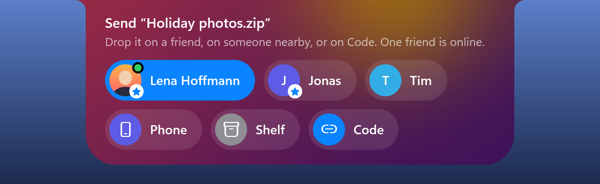

Holm 1.8.0 adds profiles: a picture, a name, a status and a color that your friends see.

## Download

| File | For whom |
| --- | --- |
| **Holm-1.8.0-win-x64.zip** | Unzip and run `Holm.exe`; also used by Holm's automatic updater. |
| **Holm.exe** | Run the self-contained app directly; no .NET installation needed. |

Requires Windows 10 (2004 or newer) or Windows 11, x64.

Holm is not code-signed, so Windows SmartScreen may warn on first launch. Click **More info → Run anyway** to launch it.

### Added
- **Profiles.** Choose a picture, a name, a status line and a color for your initials, at the top of *Settings…* or with Friends › *Edit my profile…*. Your friends see your picture wherever they used to see your initials (sharing, file offers, waves), and your status in their Friends menu. It goes only to your friends, sealed like every friend note. Friends on an older Holm keep seeing your initials until they update.
- **Friends in the Friends menu.** Each friend with their picture, status and whether their Holm is online.

### Changed
- The name in your profile is also the one people nearby and friends see when you send files; empty means your Windows name, as before.
- The settings window scrolls when it would be taller than the screen.

