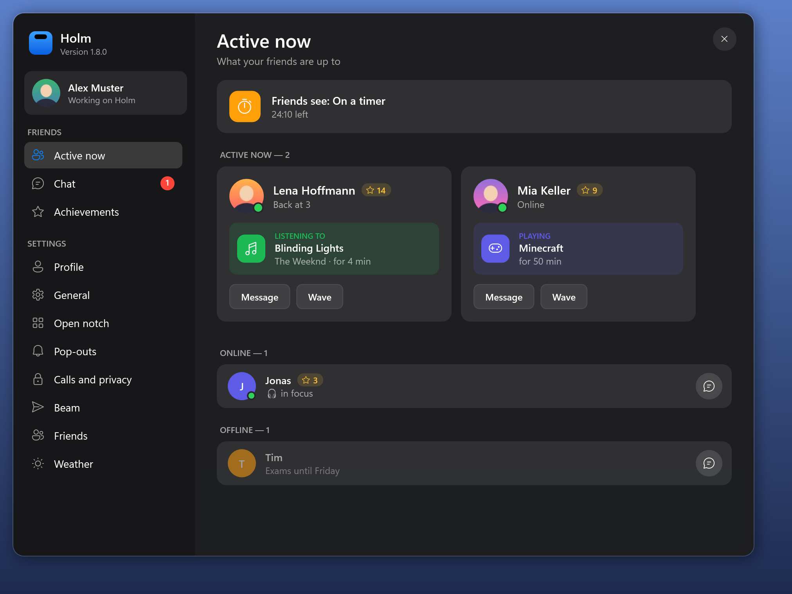

Holm 1.9.0 brings chat, Active now, screen streaming and achievements for you and your friends, in a redesigned Holm window.

## Download

| File | For whom |
| --- | --- |
| **Holm-1.9.0-win-x64.zip** | Unzip and run `Holm.exe`; also used by Holm's automatic updater. |
| **Holm.exe** | Run the self-contained app directly; no .NET installation needed. |

Requires Windows 10 (2004 or newer) or Windows 11, x64.

Holm is not code-signed, so Windows SmartScreen may warn on first launch. Click **More info → Run anyway** to launch it.

### Added
- **The Holm window.** *Settings…* and *Friends and chat…* open one window with a sidebar: your profile card, **Active now**, **Chat** and **Achievements** on top, then the settings one page at a time, each switch with an icon and a line of help.
- **Chat.** Message your friends from the Holm window. Messages are sealed so only the two of you can read them, and reach a friend whose Holm is closed when it starts (within about 12 hours). A new message pops out of the notch with *Reply*.
- **Active now.** See what your friends are up to: the song they listen to, a call, the game they play, a timer, or that they're live, with *Message*, *Wave* and *Stream to*. *Settings › Friends › Share my activity* turns sharing yours off.
- **Streaming.** Invite a friend to watch your screen (Friends › *Stream my screen to*, or from a chat). They click *Watch* and see your screen in a window; you see a LIVE badge with *Stop*. Your notch, the badge and the Holm window stay out of the stream, so your messages and chats don't go along.
- **Achievements.** 21 of them, from your first friend to 30 days in a row, with a trophy in the notch when one unlocks. Friends only see how many you have.

Chat, activity and streaming need your friends on Holm 1.9 too; older versions simply ignore them.

