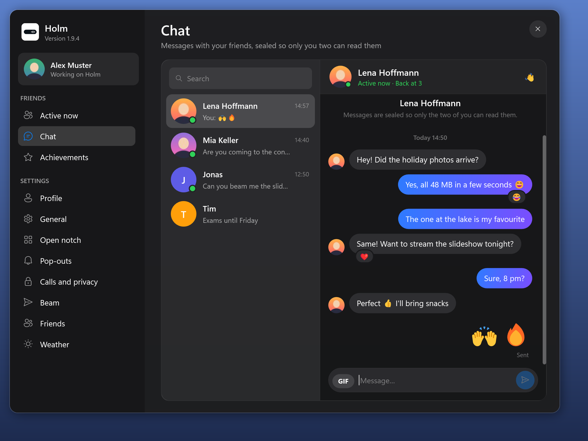

Holm 1.9.4 brings a redesigned chat, makes GIFs crash-proof and closes the notch when you click somewhere else.

## Download

| File | For whom |
| --- | --- |
| **Holm-1.9.4-win-x64.zip** | Unzip and run `Holm.exe`; also used by Holm's automatic updater. |
| **Holm.exe** | Run the self-contained app directly; no .NET installation needed. |

Requires Windows 10 (2004 or newer) or Windows 11, x64.

Holm is not code-signed, so Windows SmartScreen may warn on first launch. Click **More info → Run anyway** to launch it.

### Changed
- **A new chat.** Search your conversations, see when the last message came, and chat in bubbles that run together like in the messengers you know. Your messages get a blue-to-purple gradient, a few emoji alone show big, and the message box is round with *GIF* and a send button. Wave at a friend or share your screen right from the top of the chat.
- **Click away to close.** A click anywhere outside Holm closes the open notch and pop-outs like messages or the volume right away. Pop-outs that wait for your answer, like an incoming file, stay.

### Fixed
- **GIFs can't crash Holm any more.** Holm checks every GIF itself before showing it. A broken or oversized GIF just shows as *GIF unavailable*, and GIFs use less memory.

